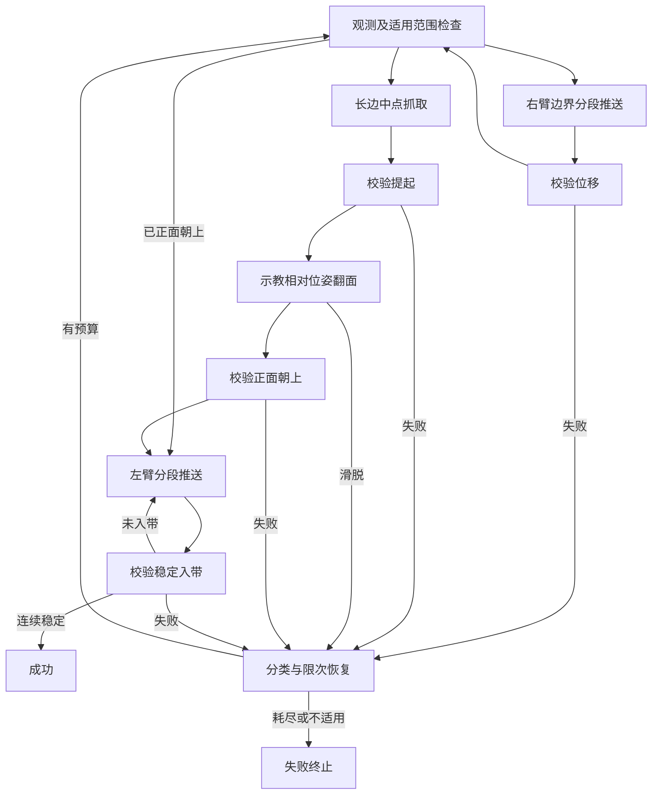

# 双臂 xArm7 包裹状态反馈 Policy

独立任务目录，复用仓库固定版本的 `graph-as-policy` 执行器，不训练神经网络。
入口是 `graph/workflow.json`，节点通过 `LiveConnector` 把工作交回仿真线程。
原任务目录不作为运行依赖；机器人模型、标签纹理和示教来源保存在本目录。

[查看 8 个过程关键帧](evidence/keyframes/index.html) ·
[关键帧总览图](evidence/keyframes/storyboard.png) ·
[下载关键帧](evidence/keyframes/keyframes.zip)。
图像来自同一轮成功的独立仿真，包含交接、夹持、提起、翻转和稳定入带，带时间及同帧俯视局部。
该可视化回合单独保存，不加入下述多位姿验收统计。

第一版范围为 **240 × 320 × 30 mm 的单件平放包裹**，支持参数化 xy、平面角和正反面。
三件同时操作、堆叠、侧立和严重折叠不在基础执行范围。
`top_first()` 先排除有上层覆盖的下层包裹，再按高度调度；第一版发现多件时给出候选顺序并拒绝动作。
这条调度规则不是已验证的堆叠分拣能力。

## 运行

从仓库根目录完成标准依赖安装（含 `[gap]`）；当前工作环境已安装固定提交
`09e45f8de27bc1a29629382ed7c2b9b4b384b3d6` 的 GaP 核心与运行时。

```bash
cd examples/live/twins/shipping_label_xarm7_feedback
./ctl up --renderer gl
./ctl reset
./ctl play 'Feedback sorting' --wait
```

`scene.py` 调用 `make_scene(center=(0.08, 0.10), yaw=0.0, face_up=False)`。
位置单位为世界坐标米，角度参数为度；观测 yaw 为弧度，绕 z 的矩形方向按 π 周期表示。
所有阈值和重试上限集中在 `config.py`。
`run/last_result.json` 保存每个阶段的时间、观测、状态、失败原因和最终结果。
`run/graph_trace/<时间戳>/` 保存交互运行的 GaP 执行轨迹；物理矩阵每回合使用独立目录。

## 流程



观测使用上下两层粒子的对应关系计算带符号法向，用局部边缘粒子计算长边中点、切向、厚度，
另外记录平面残差、局部拉伸及法向不一致比例。每段推送重新读取边界。
抓取前读取局部形变，基于长边中点坐标系重建示教 TCP 约束，再连续求解 IK；不直接变换示教关节角。
提起后跟踪被抓取的同一组材料点，检测相对夹爪漂移；旋转途中持续检查滑脱和严重局部形变。
安全检查包括边角距离、实测夹爪开口、关节限位、IK 连续性、双臂及桌面/立柱碰撞、提起空间。

失败原因包含 `no_contact`、`empty_grasp`、`slip`、`wrong_face`、`unreachable`、
`collision`、`severe_deformation`、`unstable_belt`、工作区外和预算耗尽。
碰撞、非有限状态和跟踪误差直接终止；恢复不能通过则停止。
重试预算按失败节点累计，不因重观测或前一段成功而清零。

## 验证及实机接口

```bash
# 无物理的观测/实际 GaP 分支检查；输出不能视为分拣成功率
../../../../.venv/bin/python validation.py
../../../../.venv/bin/python semantic_checks.py

# 在 live 页进程内按固定种子生成多位姿并运行物理回合
./ctl eval 'from validation import sweep; sweep(page_sim=sim)' --wait --wait-limit 14400
```

`validation.cases()` 含固定种子的 xy 变化、±15/30/60 度、正反面和工作区边界。
每次新建场景，初始中心/角度在构建时设置，运行期间不写包裹状态。
验证脚本同时保存配置和源文件 SHA-256，以便区分版本。
物理输出在 `run/sweep.json`，按进入各阶段的回合数统计，跳过的翻面不算翻面成功。
实测结果、适用区间与限制以 `REPORT.md` 为准。
本轮范围内 9 个离散位姿完成 7 个，2 个右臂转运不可达；另 1 个越界样本正确拒绝。
两次受干扰的原测试已剔除并补测，补测均成功。数据量不支持连续工作区成功率保证。
物理 sweep 不在网页主场景中展示各回合，最终图像和逐节点读数保存在各自回合目录。
页面 Reset 会中断该页的整个测试队列。需要同时交互时，使用独立验收实例：

```bash
./ctl --run-dir run/validation_live up --scene scene.py --port 8085 --renderer gl
./ctl --run-dir run/validation_live eval 'from validation import sweep; sweep(page_sim=sim)' --wait --wait-limit 14400
```

人工拖拽、Reset 中断的回合排除统计并重新测试；本次排除清单在 `evidence/exclusions.json`。
`report_results.py` 核对测试记录的源码哈希，归档完整回合，并汇总完整阶段结果：

```bash
../../../../.venv/bin/python report_results.py run/acceptance.json run/acceptance_boundary.json run/acceptance_retest.json
# 接触对照：需等待位姿 sweep 完成
./ctl --run-dir run/validation_live eval 'from audit import contact_audit; routines["Contact audit"] = contact_audit'
./ctl --run-dir run/validation_live physics 'Contact audit' --only frozen,open,built --wait-limit 7200
```

接触对照回合单列，不混入分拣成功率。`audit.py` 只将相同控制步在页面重绘之间分批执行。


`CameraObserver(estimate_frame, clock, track_patch=...)` 是实机估计器入口，要求世界坐标、时间戳、
置信度、边角、局部法向/厚度以及同一材料点的持续跟踪；拒绝过期观测。
本目录未实现相机标定、视觉网络或实机 xArm 驱动，因此当前只能在仿真中执行。

接收带在本版为静止的接收平面，终止条件为覆盖率、正面方向、支持高度和连续稳定时间。
尚未接入原目录后来新增的运行传送带。
